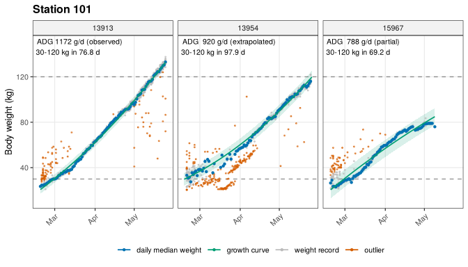

<!-- README.md is generated from README.Rmd. Please edit that file -->

# tidypptsda <a href="https://tony2015116.github.io/tidypptsda/"></a>

<!-- badges: start -->

[](https://github.com/tony2015116/tidypptsda/actions/workflows/R-CMD-check.yaml)
<!-- badges: end -->

tidypptsda cleans and analyses visit records from automatic pig feeding
stations (NEDAP and FIRE): body weight cleaning, average daily gain
(ADG), feed intake correction (ADFI) and feed conversion ratio (FCR).

- Feeder errors are flagged with the 16 criteria of Casey et al. (2005).
- Daily feed intake is corrected with the linear mixed model of Jiao et
  al. (2014).
- ADG and ADFI are computed over the same body weight stage, and every
  pig gets a confidence flag that explains how its values were obtained.
- Nothing is removed silently: each step returns a `removed` table with
  the reason.
- Few dependencies: cli, data.table, ggplot2, and MASS / nlme which ship
  with R.

## Installation

``` r
# install.packages("pak")
pak::pak("tony2015116/tidypptsda")
```

Version 0.1.0 (the earlier API) stays available:

``` r
pak::pak("tony2015116/tidypptsda@v0.1.0")
```

## Example

``` r
library(tidypptsda)

res <- run_pipeline(nedap, qc = qc_config("casey"), verbose = 0)
res

head(res$fcr$per_pig[, .(responder, adg, adfi, fcr, fcr_flag)])
#>    responder       adg     adfi      fcr fcr_flag
#> 1:     13913 1171.8790 2616.719 2.232926       ok
#> 2:     13918 1140.6265 2570.041 2.253183       ok
#> 3:     13954  919.7008 2343.422 2.548026       ok
#> 4:     13996 1265.9909 2857.824 2.257381       ok
#> 5:     14962 1249.0465 2818.537 2.256551       ok
#> 6:     15006 1270.5759 3084.452 2.427602       ok
```

Step by step, with any QC preset or setting:

``` r
qc      <- qc_config("casey", stage_range = c(30, 120))
visits  <- prep_visits(fire, qc = qc)          # or read_station("export/")
weight  <- clean_weight(visits, qc)
adg     <- calc_adg(weight)
adfi    <- calc_adfi(visits, adg)
fcr     <- calc_fcr(adg, adfi)

plot_adg(adg, weight = weight) |> save_plots("plots", suffix = "growth")
```



## References

Casey, D. S., Stern, H. S., & Dekkers, J. C. M. (2005). Identification
of errors and factors associated with errors in data from electronic
swine feeders. *Journal of Animal Science*, 83, 969-982.

Jiao, S., Maltecca, C., Gray, K. A., & Cassady, J. P. (2014). Feed
intake, average daily gain, feed efficiency, and real-time ultrasound
traits in Duroc pigs: I. *Journal of Animal Science*, 92, 2377-2386.
