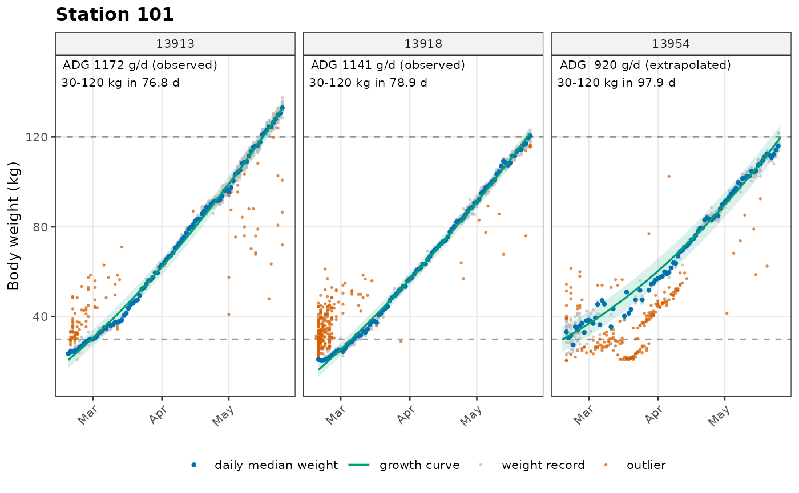
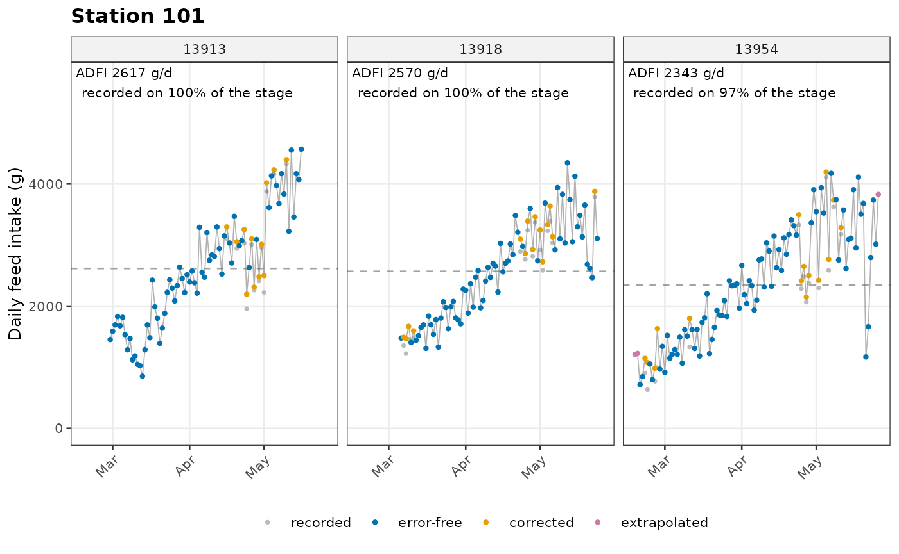

# Get started

``` r

library(tidypptsda)
```

## Example datasets

Two example datasets ship with the package, one per station type. They
are raw station exports, before any processing.

## Internal helpers

Small internal tools shared by every function of the package:

- **verbosity**: every exported function has `verbose = 0/1/2` (silent /
  summary / details). Messages go through `ppt_msg()`.
- **input checks**: `as_dt()` always returns a copy, so user objects are
  never modified; `check_cols()` reports missing columns.
- **per-pig fitting**: `fit_by_pig()` runs a function on each pig. A pig
  that fails is recorded and skipped instead of stopping everything.
- **removal log**: `new_removed()` builds the `removed` table returned
  by every analysis step.
- **result object**: `new_ppt_result()` gives every `calc_*()` function
  the same return structure.

## qc_config

All quality-control thresholds live in one object created by
[`qc_config()`](https://tony2015116.github.io/tidypptsda/reference/qc_config.md).
Three presets are available, and any single parameter can be overridden.

``` r

# Default preset
qc <- qc_config()
qc$duration_max
#> [1] 3600

# Another preset with one parameter overridden
qc_national <- qc_config("national", min_test_days = 50)
qc_national
#> 
#> ── QC settings: profile "national" ──
#> 
#> Station transfer
#>   max_gap_days: 3
#>   max_overlap_days: 1
#>   max_jump_kg: 10
#> Body weight records
#>   weight_range: 25, 140
#>   weight_outlier: loess
#>   outlier_combine: any
#>   rlm_cutoff: 0.5
#>   sd_max: 3
#>   loess_span: 0.75
#>   rel_dev_max: NULL (off)
#>   daily_drop_min: NULL (off)
#> Pig-level checks
#>   min_test_days: 50
#>   min_records: 20
#>   max_missing_rate: 0.15
#>   entry_weight_max: 65
#>   exit_weight_min: 85
#>   curve_r2_min: 0.99
#> Growth and ADG
#>   stage_range: 30, 120
#>   curve_model: loess
#>   max_extrap_days: 30
#> Feeder errors
#>   fiv_range: -20, 2000
#>   fiv0_abs_max: 20
#>   duration_max: 3600
#>   speed_fiv_lo_max: 500
#>   speed_strict_max: 110
#>   speed_range: 2, 170
#>   idle_duration_max: 500
#>   trough_diff_range: -20, 1800
#>   max_unidentified_feed_kg: 90
#> Daily feed intake
#>   dfi_range: 0, 6
#>   dfi_quantile: NULL (off)
#>   dfi_correct: lmm
#>   impute_method: loess
#>   long_gap_days: 7
#> Confidence flags
#>   max_edge_extrap_days: 15
#>   min_coverage: 0.7

# Optional rules are off (NULL) unless switched on
qc_config("casey", daily_drop_min = 0.90)$daily_drop_min
#> [1] 0.9
```

## read_station

[`read_station()`](https://tony2015116.github.io/tidypptsda/reference/read_station.md)
reads one or many station export files (or a whole folder) and stacks
them into one table. Columns are checked against the station type,
transponder IDs are always read as text so leading zeros are kept, and a
`source_file` column records where each row came from.

``` r

# Write the example data to two CSV files, then read them back
folder <- file.path(tempdir(), "fire_export")
dir.create(folder, showWarnings = FALSE)
data.table::fwrite(fire[fire$Location == 101, ], file.path(folder, "fire_101.csv"))
data.table::fwrite(fire[fire$Location == 102, ], file.path(folder, "fire_102.csv"))

raw <- read_station(folder)
#> 
#> ── Reading 2 files ─────────────────────────────────────────────────────────────
#> ℹ Detected station type "fire"
#> ✔ Read 9794 rows from 2 files (FIRE)
table(raw$source_file)
#> 
#> fire_101.csv fire_102.csv 
#>         6014         3780
attr(raw, "station")
#> [1] "fire"

unlink(folder, recursive = TRUE)
```

## prep_visits

[`prep_visits()`](https://tony2015116.github.io/tidypptsda/reference/prep_visits.md)
turns a raw NEDAP or FIRE export into one standard visit table that
every later step uses:

- one row per visit, **including unidentified visits** (no transponder
  read), marked with `identified = FALSE`. They are needed to compute
  the differences between subsequent visits on a feeder (Casey et
  al. 2005);
- the same column names and units for both stations: body weight in kg,
  feed intake and trough weights in g, times as POSIXct (UTC);
- FIRE visits that cross midnight get the right exit time;
- a body weight of 0 becomes `NA`;
- pigs seen at more than one station are kept (see **Station
  transfer**).

``` r

visits <- prep_visits(fire)
#> 
#> ── Preparing FIRE visits ───────────────────────────────────────────────────────
#> • Visits read: 9,794
#> • Unidentified visits (kept, identified = FALSE): 51
#> • FIRE visits crossing midnight (exit time corrected): 68
#> • Body weights of 0 set to NA: 478
#> • Rows without entry time (dropped): 0
#> • Duplicated rows (dropped): 0
#> ℹ No pig was seen at more than one station
#> ✔ 26 pigs at 2 stations, 9794 visits over 66 days
head(visits)
#>    responder responder_raw identified location       date seq_days seq_in_day
#>       <char>        <char>     <lgcl>   <char>     <Date>    <int>      <int>
#> 1:     35877         35877       TRUE      101 2023-12-19        1          1
#> 2:     35873         35873       TRUE      101 2023-12-19        1          1
#> 3:     35878         35878       TRUE      101 2023-12-19        1          1
#> 4:     35855         35855       TRUE      101 2023-12-19        1          1
#> 5:     35877         35877       TRUE      101 2023-12-19        1          2
#> 6:     35853         35853       TRUE      101 2023-12-19        1          1
#>    seq_in_location          entry_time           exit_time duration feed_intake
#>              <int>              <POSc>              <POSc>    <num>       <num>
#> 1:               1 2023-12-19 14:15:39 2023-12-19 14:18:02      143          46
#> 2:               2 2023-12-19 14:18:03 2023-12-19 14:23:05      302         248
#> 3:               3 2023-12-19 14:23:15 2023-12-19 14:28:45      330         201
#> 4:               4 2023-12-19 14:29:05 2023-12-19 14:34:29      324         121
#> 5:               5 2023-12-19 14:34:30 2023-12-19 14:34:37        7           0
#> 6:               6 2023-12-19 14:34:38 2023-12-19 14:36:26      108           0
#>    weight trough_in trough_out topup
#>     <num>     <num>      <num> <num>
#> 1:   67.6       678        632   286
#> 2:   60.8       632        384     0
#> 3:   70.8       670        469   286
#> 4:   51.2       755        634   286
#> 5:     NA       634        634     0
#> 6:   88.6       634        634     0

# Unidentified visits are kept for the feeder error checks
table(visits$identified)
#> 
#> FALSE  TRUE 
#>    51  9743

# Station history of each pig
head(attr(visits, "stations"))
#>    responder responder_raw location_path main_location n_locations transfer
#>       <char>        <char>        <char>        <char>       <int>   <lgcl>
#> 1:     25822         25822           101           101           1    FALSE
#> 2:     35853         35853           101           101           1    FALSE
#> 3:     35855         35855           101           101           1    FALSE
#> 4:     35862         35862           101           101           1    FALSE
#> 5:     35865         35865           101           101           1    FALSE
#> 6:     35869         35869           101           101           1    FALSE
#>     split misreads_removed weight_jump_kg
#>    <lgcl>            <int>          <num>
#> 1:  FALSE                0             NA
#> 2:  FALSE                0             NA
#> 3:  FALSE                0             NA
#> 4:  FALSE                0             NA
#> 5:  FALSE                0             NA
#> 6:  FALSE                0             NA

# NEDAP data gets the same columns and units
nedap_visits <- prep_visits(nedap, verbose = 0)
summary(nedap_visits$weight)
#>    Min. 1st Qu.  Median    Mean 3rd Qu.    Max.     NAs 
#>   20.50   43.00   80.00   77.17  106.50  147.75     391
```

## clean_weight

[`clean_weight()`](https://tony2015116.github.io/tidypptsda/reference/clean_weight.md)
cleans the body weight records of identified visits in three layers:

1.  **record rules**: weights outside `weight_range` are flagged;
2.  **outlier detection per pig**: one or more methods fit a curve to
    each pig and flag records far from it:
    - `"rlm"`: quadratic robust regression with bisquare weights
      ([`MASS::rlm`](https://rdrr.io/pkg/MASS/man/rlm.html)), records
      with weight below `rlm_cutoff` are outliers;
    - `"loess"`: robust LOESS (`family = "symmetric"`), residuals beyond
      `sd_max` robust SDs;
    - `"stl"`: STL decomposition of the daily median weight (weekly
      period, robust), residuals beyond `sd_max` robust SDs. Falls back
      to LOESS for pigs with fewer than 14 days;
    - `"sd"`: quadratic least squares, residuals beyond `sd_max` SDs;
    - optional `rel_dev_max` and `daily_drop_min` rules;
3.  **pig checks**: number of valid records, test length, missing rate,
    entry and exit weight, and optionally the curve R².

Nothing is deleted silently: every record keeps a `qc_flag`, and every
removed pig is listed in `removed` with the reason.

``` r

visits <- prep_visits(nedap, verbose = 0)
w <- clean_weight(visits)
#> 
#> ── Cleaning body weight (rlm) ──────────────────────────────────────────────────
#> • Weight records: 31,472
#> • Outside weight range: 0
#> • Outliers: 2,975
#> ! Pigs kept: 28, low confidence: 1, removed: 1
w
#> 
#> ── <ppt_weight> ──
#> 
#> Pigs: 30 (keep 28, low confidence 1, removed 1)
#> $per_pig: 30 rows x 14 columns
#> $daily: 2789 rows x 7 columns
#> $removed: 1 row x 4 columns
#> $records: 31472 rows x 9 columns
#> QC profile: "casey"

# Why pigs were removed
w$removed
#>    responder location         step                 reason
#>       <char>   <char>       <char>                 <char>
#> 1:     15964      101 clean_weight test period 2 d < 35 d

# Records flagged as outliers
head(w$records[outlier == TRUE])
#>    responder location       date seq_days          entry_time weight   fitted
#>       <char>   <char>     <Date>    <int>              <POSc>  <num>    <num>
#> 1:     13913      101 2024-02-20        2 2024-02-20 01:05:04   31.0 21.48760
#> 2:     13913      101 2024-02-20        2 2024-02-20 06:52:21   28.5 21.69242
#> 3:     13913      101 2024-02-20        2 2024-02-20 06:53:50   29.5 21.69330
#> 4:     13913      101 2024-02-20        2 2024-02-20 08:46:55   30.0 21.76008
#> 5:     13913      101 2024-02-20        2 2024-02-20 11:28:05   29.5 21.85532
#> 6:     13913      101 2024-02-20        2 2024-02-20 11:32:56   27.5 21.85819
#>    outlier qc_flag
#>     <lgcl>  <char>
#> 1:    TRUE     rlm
#> 2:    TRUE     rlm
#> 3:    TRUE     rlm
#> 4:    TRUE     rlm
#> 5:    TRUE     rlm
#> 6:    TRUE     rlm

# Another QC preset
w_national <- clean_weight(visits, qc = qc_config("national"), verbose = 0)
table(w_national$per_pig$status)
#> 
#>           keep low_confidence        removed 
#>             26              3              1
```

## calc_adg

[`calc_adg()`](https://tony2015116.github.io/tidypptsda/reference/calc_adg.md)
estimates average daily gain (ADG) over the body weight stage
`stage_range` (default 30-120 kg):

1.  a growth curve is fitted to the valid weight records of each pig
    (`curve_model`: polynomial, robust LOESS or Gompertz; Gompertz falls
    back to a quadratic curve when it does not converge);
2.  the times at which the curve reaches the lower and upper stage
    weight are found, searching up to `max_extrap_days` before the first
    and after the last record;
3.  ADG = weight difference / days between these two times.

Every pig gets an `adg_type`:

- `"observed"`: both stage limits are reached inside the recorded
  period;
- `"extrapolated"`: at least one limit needs extrapolation, but no more
  than `max_extrap_days`;
- `"partial"`: a limit is not reached even after extrapolation. ADG is
  then the mean slope of the curve over the part of the stage that is
  covered;
- `"none"`: less than 7 days of the stage are covered; ADG is `NA`.

``` r

visits <- prep_visits(nedap, verbose = 0)
w <- clean_weight(visits, verbose = 0)
adg <- calc_adg(w)
#> 
#> ── ADG over 30-120 kg (poly2 curve) ────────────────────────────────────────────
#> • Observed (stage inside the records): 24
#> • Extrapolated: 4
#> • Partial (stage not fully reached): 1
#> • No ADG: 0
#> Warning: 1 pig do not reach the whole stage: ADG is based on part of it (adg_type =
#> "partial").
#> ✔ Mean ADG: 1160 g/d (SD 124)
head(adg$per_pig[, .(responder, adg_type, start_date, end_date, stage_days, adg)])
#>    responder     adg_type start_date   end_date stage_days       adg
#>       <char>       <char>     <Date>     <Date>      <num>     <num>
#> 1:     13913     observed 2024-02-29 2024-05-16   76.79974 1171.8790
#> 2:     13918     observed 2024-03-06 2024-05-24   78.90401 1140.6265
#> 3:     13954 extrapolated 2024-02-18 2024-05-26   97.85791  919.7008
#> 4:     13996     observed 2024-02-26 2024-05-08   71.09056 1265.9909
#> 5:     14962     observed 2024-02-25 2024-05-07   72.05496 1249.0465
#> 6:     15006     observed 2024-02-26 2024-05-07   70.83402 1270.5759

# Gompertz curve, with quadratic fallback
adg_g <- calc_adg(w, qc = qc_config("casey", curve_model = "gompertz"), verbose = 0)
table(adg_g$per_pig$curve_used)
#> 
#>                gompertz poly2 (gompertz failed) 
#>                      28                       1
```

## flag_feed_errors

[`flag_feed_errors()`](https://tony2015116.github.io/tidypptsda/reference/flag_feed_errors.md)
applies the 16 error criteria of Casey et al. (2005, Table 3) to every
visit.

The seven variables are computed on the **complete visit sequence of
each feeder**, including unidentified visits, sorted by entrance time:

- FIV = feed intake per visit (g), OTV = occupation time (s), FRV = FIV
  / (OTV / 60) (g/min, not computed when OTV \<= 0);
- LWD = trough weight at entrance of the following visit - at exit of
  this visit; FWD = trough weight at entrance of this visit - at exit of
  the preceding visit (FIRE only, NEDAP has no trough weights);
- LTD = entrance time of the following visit - exit time of this visit;
  FTD = entrance time of this visit - exit time of the preceding visit.

| \# | Error | Visits considered | Threshold (default) |
|----|----|----|----|
| 1 | FIV-lo | all | FIV \< -20 g |
| 2 | FIV-hi | all | FIV \> 2000 g |
| 3 | FIV-0 | OTV = 0 | \|FIV\| \> 20 g |
| 4 | OTV-lo | all | OTV \< 0 s |
| 5 | OTV-hi | all | OTV \> 3600 s |
| 6 | FRV-hi-FIV-lo | 0 \< FIV \< 50 g | FRV \> 500 g/min |
| 7 | FRV-hi-strict | FIV \>= 50 g, preceding or following visit FIV \< -20 g | FRV \> 110 g/min |
| 8 | FRV-hi | FIV \>= 50 g, neither neighbour FIV \< -20 g | FRV \> 170 g/min |
| 9 | FRV-0 | FRV = 0 | OTV \> 500 s |
| 10 | FRV-lo | FRV != 0 | \|FRV\| \<= 2 g/min |
| 11-12 | LWD-lo / LWD-hi | all but the last visit on the feeder | LWD \< -20 g / \> 1800 g |
| 13-14 | FWD-lo / FWD-hi | all but the first visit on the feeder | FWD \< -20 g / \> 1800 g |
| 15 | LTD-lo | all but the last visit | LTD \< 0 s |
| 16 | FTD-lo | all but the first visit | FTD \< 0 s |

The thresholds come from \[qc_config()\]. Feed disappearance in
unidentified visits (-20 g \<= FIV \<= 2000 g) is summed per feeder;
Casey et al. discarded pens above 90 kg, here a warning is given above
`max_unidentified_feed_kg`.

``` r

visits <- prep_visits(fire, verbose = 0)
flagged <- flag_feed_errors(visits, verbose = 2)
#> 
#> ── Flagging feeder errors (Casey et al. 2005) ──────────────────────────────────
#> ℹ Visits with at least one error: 2.62% of 9743 identified visits
#> • FRV-lo: 64 (0.66%)
#> • LWD-hi: 60 (0.62%)
#> • FWD-hi: 60 (0.62%)
#> • FIV-lo: 33 (0.34%)
#> • FRV-hi: 28 (0.29%)
#> • FIV-hi: 21 (0.22%)
#> • LWD-lo: 5 (0.05%)
#> • FRV-hi-strict: 4 (0.04%)
#> • FWD-lo: 4 (0.04%)
#> • FRV-0: 1 (0.01%)
attr(flagged, "feeders")
#>    location n_visits n_unidentified unidentified_feed_kg error_rate
#>      <char>    <int>          <int>                <num>      <num>
#> 1:      101     6014             30                2.148 0.01788102
#> 2:      102     3780             21                0.621 0.03937217
```

## calc_adfi

[`calc_adfi()`](https://tony2015116.github.io/tidypptsda/reference/calc_adfi.md)
estimates average daily feed intake (ADFI) over the same body weight
stage as \[calc_adg()\], so that FCR compares like with like.

**Correction** (Jiao et al. 2014, after Casey et al. 2005): for each pig
and day, the error-free intake `y` (sum of FIV over visits without
error) is modelled with a linear mixed model fitted on **all** pig-days:

`y ~ location + BW + ADG + 16 x PTE + 11 x OTD + 4 x FID + (1 | pig)`

- PTE: share of the day’s visits with error type p; OTD: occupation time
  of visits with error p (types 1, 2, 6-14); FID: feed intake of visits
  with error p (types 4, 5, 15, 16);
- BW: predicted body weight of the day from \[calc_adg()\]; ADG of the
  pig;
- `location` is a fixed effect when there is more than one station.

The corrected intake is `y - sum(b x error covariates)`: only the
effects of the error covariates are removed, so a day without errors
keeps its recorded intake. Covariates without variation or perfectly
collinear with others are dropped before fitting. Days on which every
visit has an error have no error-free intake and are imputed.

**Checks and imputation** over the stage days of each pig:

- corrected intake below 0, outside `dfi_range`, or outside the optional
  `dfi_quantile` limits is set to missing;
- `impute_method = "linear"` (default): linear interpolation inside the
  recorded period (`"iii"`), robust LOESS for gaps longer than
  `long_gap_days`, and a per-pig regression of intake on body weight
  outside the recorded period (`"elrp"`);
- `impute_method = "loess"`: a robust LOESS of daily intake over days,
  used both inside and outside the recorded period.

A simulation on the example data (random gaps, long gaps, late entry,
early exit) found no curve better than the others in every situation:
precision depends mainly on how many days are missing at the stage ends,
which is why such pigs are flagged by \[calc_fcr()\].

Day states: `"org"` (no error, recorded value), `"corr"` (corrected),
`"iii"` (interpolated), `"elrp"` (extrapolated), `"missing"`.

``` r

visits <- prep_visits(nedap, verbose = 0)
w <- clean_weight(visits, verbose = 0)
adg <- calc_adg(w, verbose = 0)
adfi <- calc_adfi(visits, adg)
#> 
#> ── Flagging feeder errors (Casey et al. 2005) ──────────────────────────────────
#> ℹ Visits with at least one error: 1.58% of 31652 identified visits
#> 
#> ── ADFI over 30-120 kg ─────────────────────────────────────────────────────────
#> ℹ Correction model: 2772 pig-days, 11 error covariates
#> • Stage days recorded without error (org): 1,959
#> • Corrected (corr): 280
#> • Interpolated (iii): 1
#> • Extrapolated (elrp): 27
#> • Missing: 0
#> • Pig-days outside dfi_range: 0
#> ✔ Mean ADFI over the stage: 2801 g/d
head(adfi$per_pig)
#>    responder location  stage     adfi     adg_type adfi_raw adfi_error_free
#>       <char>   <char> <char>    <num>       <char>    <num>           <num>
#> 1:     13913      101 30-120 2616.719     observed 2596.513        2595.679
#> 2:     13918      101 30-120 2570.041     observed 2540.500        2539.662
#> 3:     13954      101 30-120 2343.422 extrapolated 2317.260        2312.906
#> 4:     13996      101 30-120 2857.824     observed 2835.890        2832.712
#> 5:     14962      101 30-120 2818.537     observed 2800.425        2800.137
#> 6:     15006      101 30-120 3084.452     observed 3071.028        3070.833
#>    n_stage_days n_observed n_corrected n_interpolated n_extrapolated n_missing
#>           <int>      <int>       <int>          <int>          <int>     <int>
#> 1:           78         78          12              0              0         0
#> 2:           80         80          15              0              0         0
#> 3:           99         96          15              0              3         0
#> 4:           73         73           8              0              0         0
#> 5:           73         73           9              0              0         0
#> 6:           72         72           7              0              0         0
#>    n_extrap_start n_extrap_end coverage
#>             <int>        <int>    <num>
#> 1:              0            0 1.000000
#> 2:              0            0 1.000000
#> 3:              2            1 0.969697
#> 4:              0            0 1.000000
#> 5:              0            0 1.000000
#> 6:              0            0 1.000000
table(adfi$daily[in_stage == TRUE, state])
#> 
#> corr elrp  iii  org 
#>  280   27    1 1959
head(adfi$model)
#>           term      estimate    std_error      p_value
#>         <char>         <num>        <num>        <num>
#> 1: (Intercept)   -883.565535  294.8491609 2.754031e-03
#> 2: location102    -75.207468   60.1144632 2.220494e-01
#> 3:          bw     24.930643    0.3435384 0.000000e+00
#> 4:         adg      1.557668    0.2481584 1.209946e-06
#> 5:  pte_fiv_hi -12786.859956 6072.7882287 3.533023e-02
#> 6:  pte_otv_hi  -2668.620256 3480.0227004 4.432430e-01
```

## calc_fcr

[`calc_fcr()`](https://tony2015116.github.io/tidypptsda/reference/calc_fcr.md)
combines ADG and ADFI, both computed over the same body weight stage,
into the feed conversion ratio FCR = ADFI / ADG (kg feed per kg gain)
and its inverse, feed efficiency G:F = ADG / ADFI.

Each pig gets `fcr_flag = "ok"` or `"low_confidence"`, with the reasons
in `fcr_note`: the growth curve or the feed intake extrapolated over
more than `max_edge_extrap_days` (default 15) at the start or end of the
stage, ADG on part of the stage only, less than `min_coverage` (default
0.7) of the stage with recorded feed intake, or weight data flagged by
\[clean_weight()\].

``` r

visits <- prep_visits(nedap, verbose = 0)
adg <- calc_adg(clean_weight(visits, verbose = 0), verbose = 0)
adfi <- calc_adfi(visits, adg, verbose = 0)
fcr <- calc_fcr(adg, adfi)
#> 
#> ── FCR over 30-120 kg ──────────────────────────────────────────────────────────
#> ℹ FCR for 29 pigs: 28 ok, 1 low confidence
#> ✔ Mean FCR 2.41 (SD 0.15), ADG 1160 g/d, ADFI 2801 g/d
head(fcr$per_pig[, .(responder, adg, adfi, fcr, fcr_flag, fcr_note)])
#>    responder       adg     adfi      fcr fcr_flag fcr_note
#>       <char>     <num>    <num>    <num>   <char>   <char>
#> 1:     13913 1171.8790 2616.719 2.232926       ok         
#> 2:     13918 1140.6265 2570.041 2.253183       ok         
#> 3:     13954  919.7008 2343.422 2.548026       ok         
#> 4:     13996 1265.9909 2857.824 2.257381       ok         
#> 5:     14962 1249.0465 2818.537 2.256551       ok         
#> 6:     15006 1270.5759 3084.452 2.427602       ok
fcr$summary[group == "all"]
#>     group        trait     n          min          max       median
#>    <char>       <char> <int>        <num>        <num>        <num>
#> 1:    all          adg    29  788.2016246 1329.9939338 1195.4404810
#> 2:    all         adfi    29 1918.5410620 3517.5385488 2808.5847425
#> 3:    all          fcr    29    2.2266875    2.8288859    2.4117169
#> 4:    all           gf    29    0.3534961    0.4490976    0.4146424
#> 5:    all   stage_days    29   67.6694817   97.8579101   74.8865629
#> 6:    all start_weight    29   29.9999831   30.0000041   29.9999981
#> 7:    all   end_weight    29   84.5754696  120.0000029  119.9999988
#>            mean           sd           cv
#>           <num>        <num>        <num>
#> 1: 1159.9380965 1.240203e+02 1.069198e-01
#> 2: 2800.9155080 3.523560e+02 1.258003e-01
#> 3:    2.4144006 1.469139e-01 6.084903e-02
#> 4:    0.4156041 2.428400e-02 5.843061e-02
#> 5:   77.0849839 7.744381e+00 1.004655e-01
#> 6:   29.9999977 3.864205e-06 1.288068e-07
#> 7:  118.7784622 6.578170e+00 5.538184e-02
```

## plot_adg, plot_adfi and save_plots

One plot per station, one panel per pig. Axes adapt to the data and to
`stage_range`, so no point is dropped. Colours come from a colour-blind
safe palette (Okabe-Ito) without extra packages.

``` r

visits <- prep_visits(nedap, verbose = 0)
w <- clean_weight(visits, verbose = 0)
adg <- calc_adg(w, verbose = 0)
adfi <- calc_adfi(visits, adg, verbose = 0)

g <- plot_adg(adg, weight = w, locations = "101", responders = c("13913", "13918", "13954"))
#> ✔ Created 1 growth plot
g$plot[[1]]
```



``` r


f <- plot_adfi(adfi, responders = c("13913", "13918", "13954"))
#> ✔ Created 1 feed intake plot
f$plot[[1]]
```



``` r


out <- save_plots(g, path = tempdir(), prefix = "loc", suffix = "growth", device = "pdf")
#> ✔ Saved 1 of 1 plot to /tmp/RtmpQaayMW
file.exists(out$file)
#> [1] TRUE
unlink(out$file)
```

## run_pipeline

[`run_pipeline()`](https://tony2015116.github.io/tidypptsda/reference/run_pipeline.md)
runs every step with one set of QC settings and keeps all intermediate
results.

``` r

res <- run_pipeline(fire, qc = qc_config(stage_range = c(60, 120)), verbose = 0)
res
#> 
#> ── tidypptsda pipeline (FIRE, profile "casey") ──
#> 
#> • Pigs in the data: 26
#> • Pigs with weight data kept: 25
#> • Pigs with ADG: 25
#> • Pigs with FCR: 25 (25 ok, 0 low confidence)
#> • Removed pigs: 1 (see $removed)
#> Mean ADG 1226 g/d, ADFI 3266 g/d, FCR 2.67
res$fcr$summary[group == "all"]
#>     group        trait     n         min          max       median        mean
#>    <char>       <char> <int>       <num>        <num>        <num>       <num>
#> 1:    all          adg    25  937.148002 1554.7635738 1238.2756911 1226.292755
#> 2:    all         adfi    25 2572.527511 3874.4621650 3243.1673513 3266.068769
#> 3:    all          fcr    25    2.261206    3.0879735    2.6424840    2.674295
#> 4:    all           gf    25    0.323837    0.4422418    0.3784318    0.375591
#> 5:    all   stage_days    25   38.591072   64.0240415   48.4544758   49.422974
#> 6:    all start_weight    25   59.999985   60.0000093   59.9999980   59.999997
#> 7:    all   end_weight    25  119.999985  120.0000104  119.9999970  119.999997
#>              sd           cv
#>           <num>        <num>
#> 1: 1.245986e+02 1.016059e-01
#> 2: 2.595311e+02 7.946285e-02
#> 3: 1.816529e-01 6.792553e-02
#> 4: 2.559708e-02 6.815148e-02
#> 5: 5.149714e+00 1.041968e-01
#> 6: 4.429726e-06 7.382877e-08
#> 7: 4.537231e-06 3.781026e-08
```

## Deprecated functions

Function names of earlier versions still work for one version. They show
a deprecation warning and call the new function. Their results have the
new structure (see each new function).
